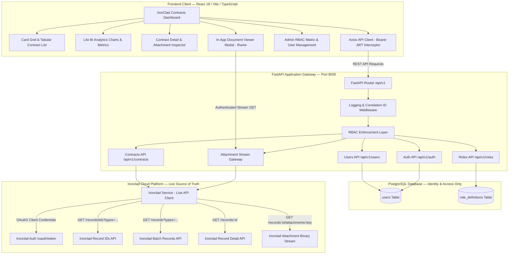
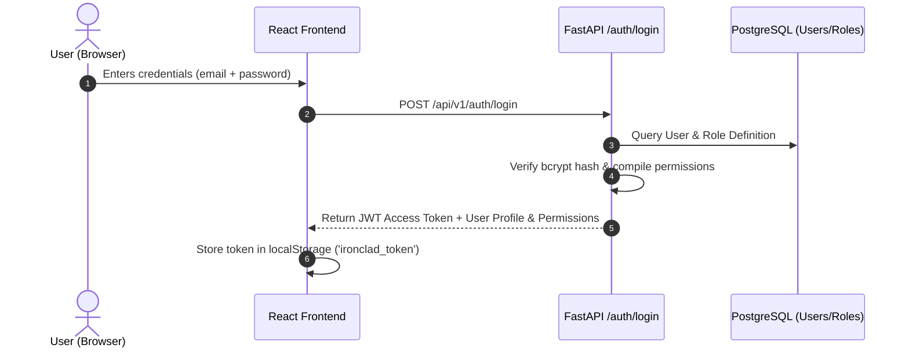
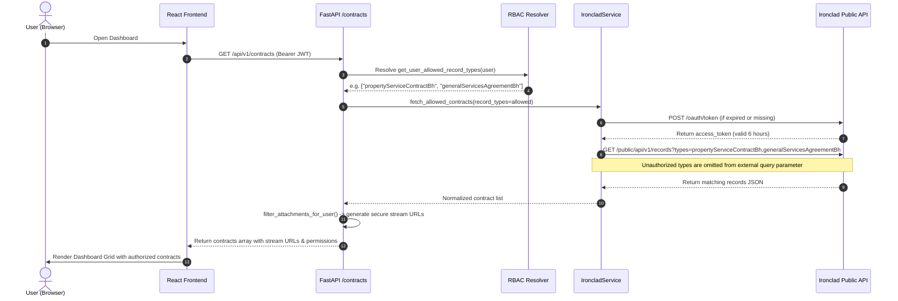
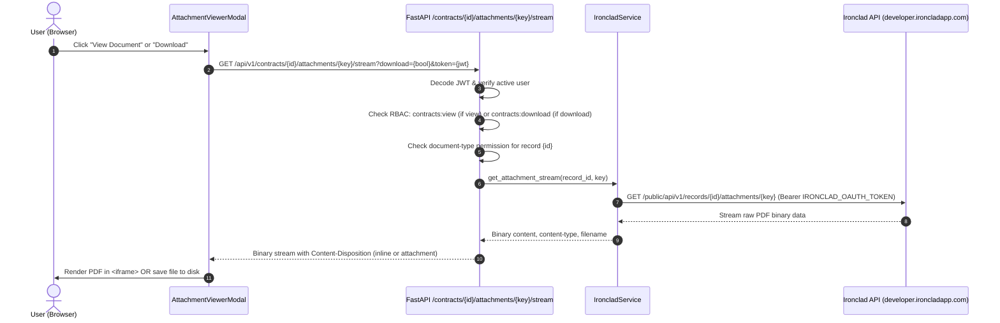

# IronClad Contracts — System Architecture & Technical Design (v2.1)

## 1. High-Level Architectural Overview

**IronClad Contracts** is an enterprise-grade, **Zero-Persistence Live Contract Integration Platform** built with FastAPI and React/TypeScript. It combines real-time synchronization with the Ironclad Public API (`developer.ironcladapp.com`) and an internal PostgreSQL-powered **Role-Based Access Control (RBAC)** security engine.

---

## 2. Core Architectural Principles

1. **Zero Database Contract Persistence**: Contract agreements, records, and document metadata are **never** stored in PostgreSQL. The PostgreSQL database is used **exclusively** for User Identity, Roles, and Granular Permission Policies (View, Download, and Document-Type Access).
2. **Live Ironclad API as Single Source of Truth**: All contract records, metadata properties, and document attachments are queried directly and in real time from the Ironclad API (`developer.ironcladapp.com`).
3. **Automated OAuth2 Token Lifecycle**: The backend operates using `IRONCLAD_CLIENT_ID` and `IRONCLAD_CLIENT_SECRET`. It autonomously negotiates OAuth access tokens with scope `public.records.readRecords` and handles background token refresh transparently.
4. **Secure Attachment Streaming Gateway**: Direct Ironclad document links are never exposed to the client browser to prevent API credential leakage. All attachment previews and downloads are routed through a secure backend streaming gateway that authenticates user JWTs and fetches files using server-side OAuth tokens.
5. **Granular Document-Type Access Control**: Permission policies control which of the 3 allowed contract types a user can view. Unauthorized document types are **never** queried from external Ironclad endpoints for that user.
6. **Strict Record Type Whitelisting**: Only the following three allowed record types are processed:
   - `Property Service Contract (BH)` / `propertyServiceContractBh`
   - `Purchase & Sale Agreement (BH)` / `purchaseSaleAgreementBh`
   - `General Services Agreement (BH)` / `generalServicesAgreementBh`

---

## 3. Technology & Tools Stack

| Layer | Technology / Tool | Version | Purpose |
| :--- | :--- | :--- | :--- |
| **Frontend Framework** | **React** | `18.2.0` | Declarative component UI library |
| **Build Tool & Bundler** | **Vite** | `5.0.8` | Next-generation fast frontend dev server & bundle pipeline |
| **Language (Frontend)** | **TypeScript** | `5.2.2` | Strong static typing for contracts, schemas, and RBAC states |
| **Icons & Visuals** | **Lucide React** | `^0.344.0` | Clean enterprise icon system |
| **Data Visualization** | **Chart.js & React-Chartjs-2** | `^4.4.1` | Doughnut, Bar, and Line analytics for the Lite BI Tool |
| **HTTP Client** | **Axios** | `^1.6.7` | Client with automated JWT bearer interceptors & timeout safeguards |
| **Backend Framework** | **FastAPI** | `^0.109.0` | High-performance asynchronous Python web API framework |
| **Server Engine** | **Uvicorn** | `^0.27.0` | Lightning-fast ASGI web server |
| **HTTP Client (Backend)**| **HTTPX** | `^0.26.0` | Async HTTP client for OAuth2 & Ironclad API communication |
| **Database ORM** | **SQLAlchemy** | `^2.0.25` | Object-Relational Mapping for User and Role models |
| **Database Engine** | **PostgreSQL** | `>= 14` | Relational storage for users, hashed credentials, and role policies |
| **Security & Auth** | **python-jose & bcrypt**| `^3.3.0` | JWT token signing, verification, and salted password hashing |
| **Configuration** | **pydantic-settings** | `^2.1.0` | Strongly-typed environment configuration validation |

---

## 4. End-to-End Data Flow

### 4.1 Login & RBAC Initialization

### 4.2 Document-Type Filtered Contract Retrieval

### 4.3 Secure Attachment Streaming & Download

---

## 5. Security & Permission Policy Architecture

### 5.1 Permission Policy Matrix
| Permission Key | Policy Name | Scope & Effect |
| :--- | :--- | :--- |
| `contracts:view` | View Contracts (General) | Base access to dashboard, summary cards, and search filters. |
| `contracts:view:property_service` | View Property Service | Authorizes viewing *Property Service Contract (BH)* records. |
| `contracts:view:purchase_sale` | View Purchase & Sale | Authorizes viewing *Purchase & Sale Agreement (BH)* records. |
| `contracts:view:general_services` | View General Services | Authorizes viewing *General Services Agreement (BH)* records. |
| `contracts:download` | Download Documents | Enables download buttons and authorizes binary document downloads. |
| `users:manage` | Manage Users | Permission to create, edit, activate, or deactivate users. |
| `roles:manage` | Manage Roles | Permission to create roles and update permission policies. |

### 5.2 Stream Gateway Security Rules
1. **Zero Client-Side Credentials**: The client browser never sees the Ironclad Client ID, Secret, or OAuth access token.
2. **Dual-Channel Authentication**: The streaming gateway supports both `Authorization: Bearer <token>` headers (used by AJAX/fetch) and `?token=<jwt>` query parameters (used by `<iframe>` and direct anchor download tags).
3. **Double Verification**: Both the action permission (`contracts:view` or `contracts:download`) and the document type permission (`contracts:view:<type>`) are checked before streaming any file bytes.

---

## 6. What the Application Displays (UI/UX Breakdown)

### 1. Dashboard View (`/dashboard`)
- **Card Grid View**: Responsive 3-column card layout showing Contract Title, Ironclad ID Badge, Counterparty, Status, Effective/Expiration dates, and Portfolio Value.
- **Table View**: Dense tabular data view with sortable columns, status pills, and quick action buttons.
- **Lite BI Tool Tab**: Interactive executive analytics dashboard:
  - Total Portfolio Valuation & Active/Signed contract metrics.
  - Doughnut Chart: Contract Status Distribution.
  - Bar Chart: Department Distribution.
  - Bar Chart: Top 5 Counterparty Exposure.
  - Line Chart: Monthly Agreement Volume Trends.
- **Filtering & Search**: Real-time filtering by Allowed Contract Type, search query by title/counterparty/ID, and responsive pagination (5, 10, 20, 50 per page).

### 2. Contract Detail Modal & Page (`/contracts/:id`)
- **Header**: Document title, Ironclad UUID copy-to-clipboard badge, enhanced workflow status indicator.
- **Contract Terms & Renewals**: Agreement Date, Effective Date, Expiration Date, Renewal Type, Initial Term Length, Notice Periods, and Renewal Opt-Out Dates.
- **Property & Entity Association**: Contracting Entity, Property ID, Community Name, and Internal Department.
- **Attachments & Documents**: List of all official agreement files showing File Format, Key, and permission-aware action buttons:
  - **View Document**: Opens the In-App Document Viewer Modal or browser tab. Disabled with Lock icon if user lacks `contracts:view`.
  - **Download**: Directly downloads the original PDF binary. Disabled with Lock icon if user lacks `contracts:download`.
  - **Copy Link**: Copies the authenticated streaming link to the clipboard.

### 3. In-App Document Viewer Modal
- Fullscreen responsive overlay with glassmorphism backdrop.
- Embedded high-fidelity PDF Viewer (`<iframe>` backed by the secure streaming proxy).
- In-modal quick download button and fullscreen toggle.

### 4. Admin Roles & User Management (`/admin/roles`)
- **Users Matrix**: List of system users with roles, active statuses, and assigned permission tags. Modal to create and edit user credentials and permission policies.
- **Roles Matrix**: System roles (`admin`, `manager`, `editor`, `viewer`, plus custom roles) with editable default permission checklists.
- **Authorized Record Types**: Live indicator of the whitelisted Ironclad contract categories.
