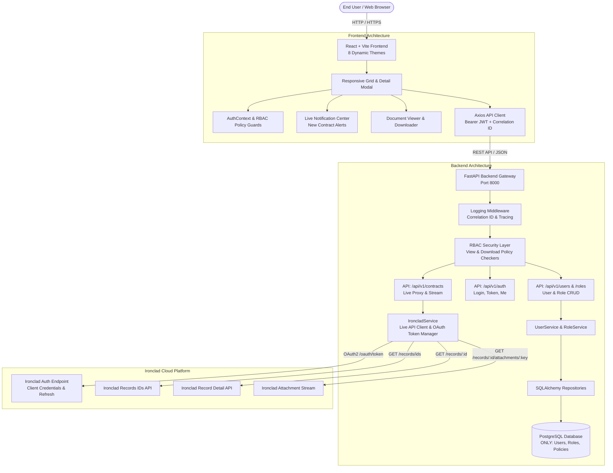
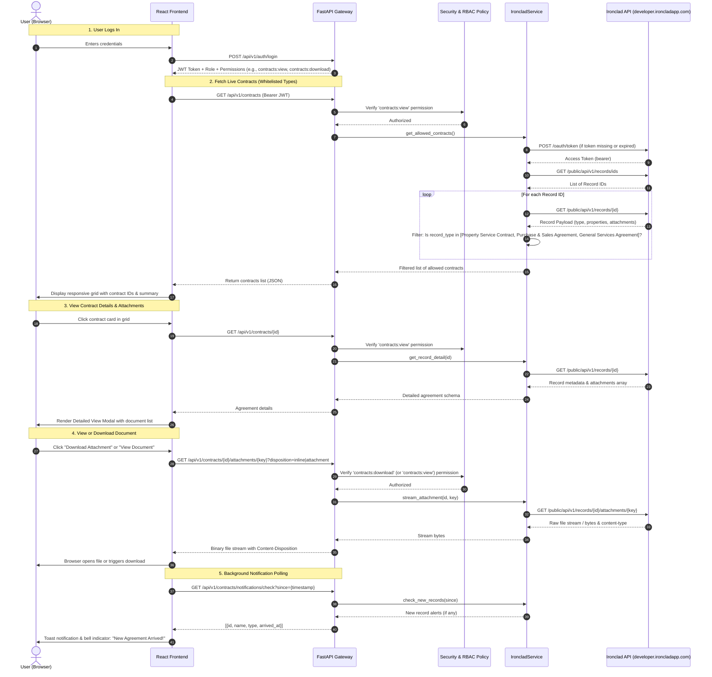

# System Architecture & Technical Design (v2.0)

## 1. High-Level Architectural Overview

The Ironclad Contract Hub has been re-architected into a **Zero-Storage Live Contract Integration Platform** with dedicated **PostgreSQL Role & Access Management (RBAC)**.

### Architectural Principles:
1. **Zero Database Contract Persistence**: Contract agreements, records, and document metadata are **never** stored in PostgreSQL. The PostgreSQL database is used **exclusively** for User Identity, Roles, and Granular Permission Policies (View & Download).
2. **Live Ironclad API as Single Source of Truth**: All contract records and document attachments are fetched directly and in real time from the Ironclad API (`developer.ironcladapp.com`).
3. **Automated OAuth2 Token Lifecycle**: The backend operates using only `IRONCLAD_CLIENT_ID` and `IRONCLAD_CLIENT_SECRET`. It autonomously negotiates OAuth access tokens and handles background token refresh transparently.
4. **Strict Record Type Whitelisting**: Only the following three allowed record types are processed and presented in the UI:
   - `Property Service Contract`
   - `Purchase & Sales Agreement`
   - `General Services Agreement`
   All other record types are strictly filtered out at the service boundary.
5. **Read & Download Only Contract Surface**: All contract mutation actions (upload, edit, delete, create) have been completely removed. Permitted operations on contracts are strictly **View Record Details** and **View/Download Document Attachments**.
6. **PostgreSQL-Powered RBAC**: Full administrative management for Users (Add, Edit, Activate) and Roles (Add, Edit) with policies for View and Download permissions, and category-level authorizations.
7. **Post-Login New Contract Notifications**: Real-time / polling notification layer that notifies the logged-in user whenever new contracts or agreements arrive from Ironclad.



---

## 2. Data Flow & Ironclad Live API Integration



---

## 3. Storage Separation & PostgreSQL Schema Design

Under the new architecture, **no contracts, documents, or workflows are stored in PostgreSQL**. The database schema is streamlined strictly for:
1. `users`: Identity, authentication credentials, assigned role key, direct permission overrides, and status.
2. `role_definitions`: Role keys (`admin`, `manager`, `editor`, `viewer`, custom roles), display names, descriptions, and allowed permission policies.

```sql
-- PostgreSQL Table: users
CREATE TABLE users (
    id SERIAL PRIMARY KEY,
    email VARCHAR(255) UNIQUE NOT NULL,
    hashed_password VARCHAR(255) NOT NULL,
    full_name VARCHAR(255) NOT NULL,
    role VARCHAR(50) NOT NULL DEFAULT 'viewer',
    permissions JSONB NOT NULL DEFAULT '[]'::jsonb,
    is_active BOOLEAN NOT NULL DEFAULT TRUE,
    created_at TIMESTAMP WITH TIME ZONE DEFAULT NOW(),
    updated_at TIMESTAMP WITH TIME ZONE DEFAULT NOW()
);

-- PostgreSQL Table: role_definitions
CREATE TABLE role_definitions (
    id SERIAL PRIMARY KEY,
    role_key VARCHAR(50) UNIQUE NOT NULL,
    display_name VARCHAR(100) NOT NULL,
    description VARCHAR(255) NOT NULL,
    default_permissions JSONB NOT NULL DEFAULT '[]'::jsonb,
    created_at TIMESTAMP WITH TIME ZONE DEFAULT NOW(),
    updated_at TIMESTAMP WITH TIME ZONE DEFAULT NOW()
);
```

### Permission Policy Matrix:
| Permission Key | Description | Applicable Roles (Default) |
|---|---|---|
| `contracts:view` | View allowed contract list and inspect detailed agreement view | `admin`, `manager`, `editor`, `viewer` |
| `contracts:download` | Download and stream original document attachments | `admin`, `manager`, `editor` |
| `users:manage` | Add new users, edit user profile, assign roles & permissions | `admin` |
| `roles:manage` | Add new roles, edit role permissions and policies | `admin` |

---

## 4. Ironclad Live API Client Architecture

The `IroncladService` (`backend/app/services/ironclad_service.py`) encapsulates all communication with `developer.ironcladapp.com`:

### 4.1 Token Lifecycle Management:
- **Client Credentials Flow**: Uses `IRONCLAD_CLIENT_ID` and `IRONCLAD_CLIENT_SECRET`.
- **Token Cache**: Access token cached in-memory with automatic expiration tracking.
- **Refresh Flow**: When token is within 60 seconds of expiration (or on HTTP 401), the service automatically negotiates a fresh access token using either the refresh token or client credentials.

### 4.2 API Endpoint Mapping:
1. `GET /public/api/v1/records/ids`: Fetches array of all record IDs.
2. `GET /public/api/v1/records/{id}`: Fetches individual record details (properties, schema, attachments).
3. `GET /public/api/v1/records/{id}/attachments/{key}`: Proxies the binary document file stream directly to the client.

### 4.3 Whitelisted Record Types:
Incoming records are checked against the whitelist:
```python
ALLOWED_RECORD_TYPES = {
    "Property Service Contract",
    "Purchase & Sales Agreement",
    "General Services Agreement"
}
```
Any record whose type does not match one of these three is automatically discarded before returning to the UI.

### 4.4 Live API Error Handling & Validation:
Requests directly hit the Ironclad Public API. If the Client ID and Client Secret are invalid or unauthorized, the client receives explicit HTTP 401/403 status responses, and the token manager proactively refreshes or logs actionable authentication error details. No mock or dummy contracts are returned or stored.

---

## 5. Frontend UI/UX Architecture

```
frontend/src/
├── api/
│   └── client.ts            # Axios singleton with Bearer token & correlation ID interceptors
├── context/
│   ├── AuthContext.tsx      # Authentication, user state, permission guards (`hasPermission`)
│   └── ThemeContext.tsx     # 8 Dynamic themes runtime switcher
├── components/
│   ├── Navbar.tsx           # Global header with theme selector, notification bell, user profile
│   ├── NotificationCenter.tsx # Live notifications for newly arrived contracts
│   ├── ContractDetailModal.tsx# Clean modal view for detailed agreement & documents
│   ├── DocumentList.tsx     # Attachment list with View & Download permission-governed buttons
│   ├── ThemeSelector.tsx    # 8-theme visual palette switcher
│   └── ProtectedRoute.tsx   # Route authorization guard
└── pages/
    ├── Dashboard.tsx        # Responsive grid of allowed contract IDs & detailed view modal
    ├── AdminRoles.tsx       # User & Role administration (Add/Edit users, Add/Edit roles & permissions)
    ├── SignIn.tsx           # Login page with 1-click test credentials
    └── Home.tsx             # System architecture & overview
```

### Obsolete Code Removed:
- Contract creation modal (`ContractModal.tsx`) & creation endpoints
- Contract update & deletion endpoints
- S3 upload widgets & upload endpoints
- Database contract persistence and sync-to-db logic
